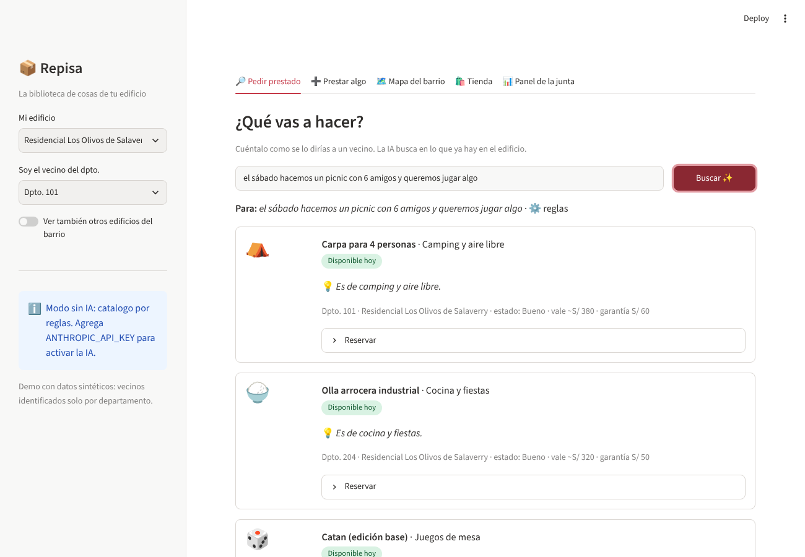
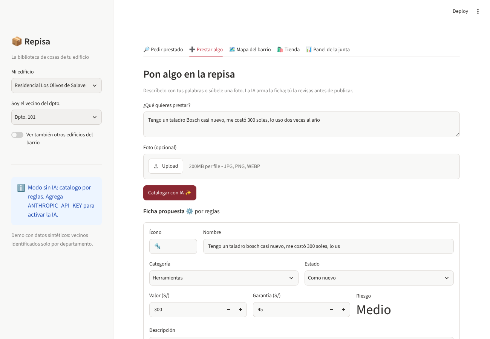
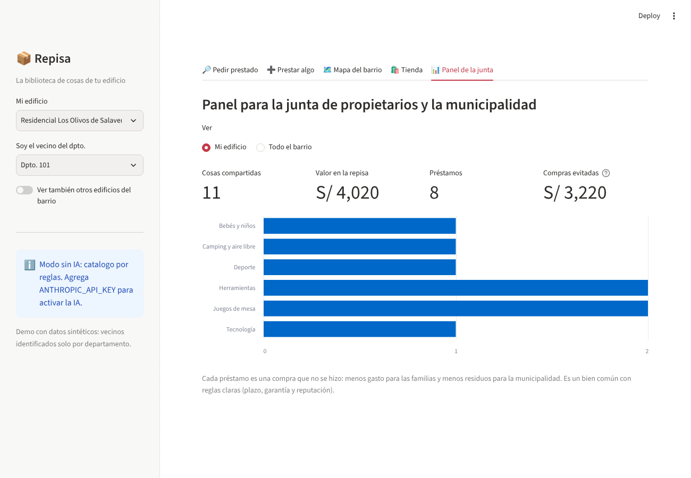
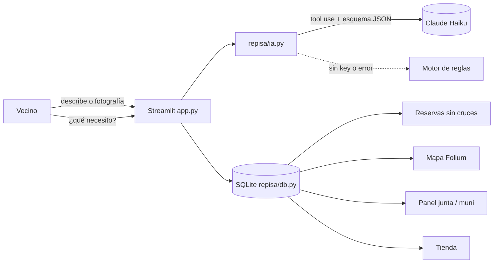

# 📦 Repisa — la biblioteca de cosas de tu edificio

> **Hacemos que los vecinos compartan lo que tienen guardado, para edificios y municipalidades, mediante un catálogo y un asistente con IA.**

**Demo:** `<<pega aquí la URL de Streamlit Cloud>>` · **Video de respaldo:** `<<link>>`
Proyecto final de la Diplomatura de Ciencia de Datos para las Ciencias Sociales y la Gestión Pública (Q-Lab PUCP), [issue #204](https://github.com/d2cml-ai/Data-Science-Python/issues/204).



---

## 1. One-liner

Hacemos que los vecinos de un edificio compartan sus cosas de uso ocasional (juegos de mesa, herramientas, carpas, coches de bebé) en lugar de que cada departamento compre la suya, mediante una app donde la IA cataloga los objetos y recomienda qué pedir prestado, con reservas, garantías y reglas claras.

## 2. Founder

Soy **Fiorella Becerril**, politóloga (PUCP) y analista en SERVIR, con más de diez años en gestión pública. Trabajo todos los días con reglas, instrumentos y entidades que administran recursos que no son de una sola persona. Repisa es eso a escala de un edificio: un **bien común** que funciona solo si tiene reglas de acceso, de uso y de sanción (Ostrom). Sé diseñar esas reglas y sé cómo hablarle a una municipalidad, que es el cliente que hace escalar el producto.

La idea nace de un amigo que quería hacer un banco de juegos de mesa para su edificio, con reservas y venta de accesorios. Yo la generalicé a cualquier objeto de uso ocasional y le agregué el ángulo de bienes comunes y de servicio municipal. **Crédito a `<<nombre de tu amigo>>`.**

## 3. Problema

**Quién lo sufre:** las familias de edificios multifamiliares en Lima, que tienen poco espacio y gastan en objetos que usan pocas veces al año. También las municipalidades, que pagan por recoger esos objetos cuando se vuelven residuos.

**Cuánto les cuesta:** un taladro, una carpa, una parrilla, un coche de bebé y tres juegos de mesa cuestan más de S/ 1,800 entre todos, y la mayoría se usa un par de veces al año. En un edificio de 40 departamentos ese gasto se repite 40 veces. A eso se suma el costo del espacio en departamentos cada vez más pequeños.

**Cómo lo resuelven hoy:** con un grupo de WhatsApp del edificio ("¿alguien tiene una escalera?"). No hay inventario, no se sabe quién lo tiene ni hasta cuándo, no hay garantía y, cuando algo se rompe, nadie sabe qué hacer. Por eso la mayoría prefiere comprar.

**Conversaciones con usuarios potenciales** (notas en [`docs/research/`](docs/research/)):

| # | Quién | Lo más importante que dijo |
|---|-------|----------------------------|
| 1 | Perfil no mencionado en el audio *(por completar)* | No le prestaría a un vecino "por si me lo malogran"; le daría confianza que la persona sepa usar la herramienta. |
| 2 | Perfil no mencionado en el audio *(por completar)* | Pide un responsable del estado de la herramienta, garantía y foto del uso. Sobre pagar: "depende de qué cosas son", sin dar monto. |
| 3 | Perfil no mencionado en el audio *(por completar)* | Prestaría a quien ya tenga historial de devolver bien; pagaría "creo que 20 soles" al mes, según la cantidad de cosas. |

## 4. Solución e insight

Repisa tiene cinco partes:

1. **Pedir prestado:** escribes lo que vas a hacer ("el sábado hacemos un picnic con 6 amigos") y la IA elige del inventario real del edificio qué te sirve, si está libre hoy, y te dice qué falta.
2. **Prestar algo:** describes el objeto con tus palabras, o le tomas una foto, y la IA arma la ficha: categoría, estado, valor, garantía sugerida, reglas de préstamo, riesgo y accesorios. Tú la revisas antes de publicar.
3. **Reservas** con calendario, sin cruces, con un plazo máximo y una garantía.
4. **Tienda:** lo durable se presta y lo que se gasta se compra (fundas, brocas, carbón). Se sugiere según lo que reservaste. Esta es la parte del negocio de mi amigo.
5. **Mapa y panel** para la junta de propietarios y la municipalidad: cuántas cosas se comparten, cuántos préstamos hubo y cuánto se dejó de comprar.

**Insight:** la gente no comparte, no por egoísmo, sino por **fricción y desconfianza**. Catalogar un objeto da flojera y prestarlo da miedo. La IA elimina la flojera (la ficha se arma en 5 segundos) y las reglas eliminan el miedo (garantía, plazo y reputación). Un grupo de WhatsApp no puede hacer ninguna de las dos cosas.

Las entrevistas lo confirman: 2 de 3 personas hoy no prestarían a un vecino ("por si me lo malogran"), y las tres condicionaron prestar a algún tipo de confianza (que sepa usarlo, garantía y responsable, o historial de préstamos cumplidos).

## 5. Why now

- Hace tres años catalogar un objeto a partir de una frase o una foto requería un formulario largo. Hoy un LLM multimodal devuelve una **ficha estructurada** confiable por una fracción de céntimo.
- Lima se construye hacia arriba: cada vez más gente vive en edificios con departamentos más pequeños, con junta de propietarios y conserjería, que es la infraestructura natural para una repisa común.
- Las municipalidades tienen metas de reducción de residuos sólidos y buscan servicios vecinales de bajo costo. Además, en enero de 2027 asumen nuevas autoridades municipales con agendas por definir.

## 6. Demo

**URL:** `<<URL pública>>`

**Correrlo en local:**

```bash
git clone https://github.com/rociobecerril/repisa.git
cd repisa
pip install -r requirements.txt
cp .env.example .env        # opcional: pon tu GEMINI_API_KEY o ANTHROPIC_API_KEY
streamlit run app.py
```

Sin API key, la app funciona igual en **modo reglas** (catálogo y recomendaciones por palabras clave), para que el demo nunca se caiga. Con la key se activa la IA.

| Pedir prestado | Prestar algo | Panel |
|---|---|---|
|  |  |  |

**Arquitectura:**



**Modelos y por qué:** la app funciona con **Gemini Flash** (`gemini-flash-latest`, por su capa gratuita) o con **Claude Haiku** (`claude-haiku-5-5`), según qué clave encuentre en los Secrets (`GEMINI_API_KEY` o `ANTHROPIC_API_KEY`). Las tareas son cortas (llenar una ficha o elegir de una lista), así que un modelo rápido y barato basta. En ambos casos la salida es estructurada: con Claude se fuerza con *tool use* y con Gemini con `response_json_schema`, usando el mismo esquema JSON de `repisa/ia.py`. Después valido categorías, estados e ids contra la base. Si la API falla, entra el motor de reglas.

## 7. Modelo de negocio

| Quién paga | Qué | Precio |
|---|---|---|
| Junta de propietarios | Repisa para su edificio (reservas, garantías, panel) | **S/ 3 por departamento al mes** (S/ 120 para 40 dptos.) |
| Municipalidad | Licencia distrital: todos los edificios del distrito, mapa y reporte de residuos evitados | **S/ 1,500 al mes** |
| Vecinos | Accesorios y consumibles de la tienda | **Comisión de 15%** |

Referencia de las entrevistas: una persona dijo que pagaría "creo que 20 soles" al mes según la cantidad de cosas disponibles; S/ 3 por departamento pagado por la junta queda muy por debajo de esa disposición a pagar.

**Costo por usuario:** catalogar un objeto o pedir una recomendación consume del orden de cientos de tokens por llamada (la app muestra el conteo real de cada una; por medir en el piloto). Un vecino activo hace pocas llamadas al mes (catalogar lo que presta y pedir recomendaciones). El costo exacto se medirá en el piloto con el conteo de tokens que muestra la app y el precio vigente de la API; se espera que sea de céntimos por departamento al mes. El servidor es gratis en Streamlit Community Cloud mientras dure el piloto. **El costo en tokens por departamento es una fracción mínima de los S/ 3 que paga.**

## 8. Herramientas del curso

| Herramienta | Sesión | Dónde está | Por qué esta |
|---|---|---|---|
| **LLMs con salidas estructuradas** | 08 | [`repisa/ia.py`](repisa/ia.py): `catalogar()` y `recomendar()` | Convierte texto libre o una foto en datos limpios y elige del inventario real sin inventar objetos. |
| **Mapas con Folium** | 06 | [`app.py`](app.py), pestaña "Mapa del barrio" | La municipalidad necesita ver dónde están las repisas y qué hay en cada edificio. |
| Despliegue | 12 | Streamlit Community Cloud | URL pública. |

## 9. Qué hizo el agente

Usé **Claude Code** como agente de programación. Generó la primera versión de `repisa/db.py` (esquema SQLite, datos sintéticos, reservas sin cruces y métricas), `repisa/ia.py` (esquemas JSON, llamadas con *tool use* y motor de reglas de respaldo), `app.py` (interfaz Streamlit) y `tests/`. Yo definí el problema, el modelo de bienes comunes (reglas de plazo, garantía y reputación), el modelo de negocio, las categorías y los precios de referencia; revisé y probé el flujo, y corregí `<<qué cambiaste tú>>`.

---

### Datos y privacidad

Todos los datos del demo son **sintéticos**: los vecinos se identifican solo por número de departamento y los edificios son direcciones genéricas de Lima. No se usan datos personales reales.

### Roadmap

- Verificación del vecino por la junta (padrón del edificio) y reputación por préstamos devueltos a tiempo.
- Garantía retenida con Yape o Plin y liberada al devolver.
- Registro por voz con Whisper para vecinos mayores.
- Piloto con un edificio y una municipalidad de Lima.

### Riesgos

Daños y pérdidas (mitigado con garantía y reputación), baja adopción inicial (empezar por juegos de mesa y herramientas, que son lo más pedido) y responsabilidad legal por accidentes (términos de uso y reglas por objeto).

Licencia MIT.
